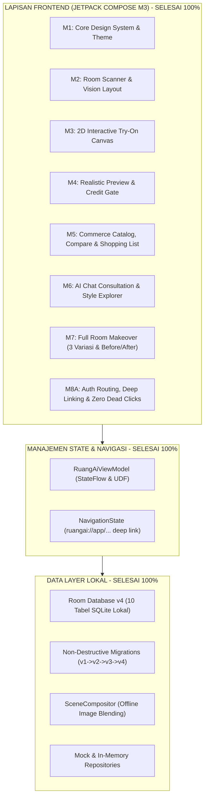
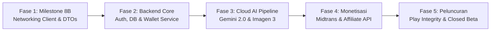

# RUANGAI (RUANGRUPA)
## DOKUMEN STATUS PROYEK, PENDEKATAN ARSITEKTUR & ROADMAP PENGEMBANGAN

> **Terakhir Diperbarui:** 12 November 2026  
> **Status Repositori:** Tersinkronisasi penuh ke remote [`https://github.com/RenoSebastian/RuangRupa.git`](https://github.com/RenoSebastian/RuangRupa.git) (Branch: `main`)  
> **Target Platform:** Android 16 (API Level 36), Min SDK 24, Kotlin 2.2.10, Jetpack Compose Material 3, Room SQLite v4  

---

## DAFTAR ISI
1. [Ringkasan Eksekutif & Karakter Produk](#1-ringkasan-eksekutif--karakter-produk)
2. [Status Pengembangan Saat Ini (Sampai Mana?)](#2-status-pengembangan-saat-ini-sampai-mana)
3. [Pendekatan & Prinsip Rekayasa yang Digunakan](#3-pendekatan--prinsip-rekayasa-yang-digunakan)
4. [Apa yang Belum Ada / Masih Kurang? (Gap Analysis Menuju Production)](#4-apa-yang-belum-ada--masih-kurang-gap-analysis-menuju-production)
5. [Rekomendasi Roadmap Pengembangan Selanjutnya](#5-rekomendasi-roadmap-pengembangan-selanjutnya)
6. [Struktur Kode & Berkas Kunci](#6-struktur-kode--berkas-kunci)

---

## 1. RINGKASAN EKSEKUTIF & KARAKTER PRODUK

RuangAI (RuangRupa) dirancang **bukan sekadar sebagai aplikasi desain interior 3D**, melainkan sebuah platform **Visual Commerce & AI Interior Designer** yang menghubungkan tiga pilar:
1. **Inspirasi & Konsultasi AI Multimodal:** Pengguna dapat berkonsultasi mengenai penataan ruangan, gaya desain, dan kendala tata ruang sesuai foto asli ruangan mereka.
2. **Visualisasi Interaktif (Virtual Try-On & Full Makeover):** Pengguna dapat menempelkan furnitur nyata secara 2D tanpa merusak foto ruangan asli, atau menghasilkan renovasi menyeluruh (*full room makeover*) dengan variasi desain.
3. **Monetisasi Commerce Terintegrasi (Affiliate Marketplace):** Setiap furnitur yang direkomendasikan dan divisualisasikan memiliki data produk nyata di marketplace Indonesia (Shopee, Tokopedia/TikTok Shop, Lazada) dengan tautan atribusi afiliasi otomatis.

---

## 2. STATUS PENGEMBANGAN SAAT INI (SAMPAI MANA?)

Hingga saat ini, aplikasi telah menyelesaikan **seluruh lapisan antarmuka pengguna (Frontend UI/UX), mesin grafis 2D lokal, dan lapisan basis data lokal (Milestone 1 s.d. 8A)**. Seluruh fitur dapat dijalankan secara mandiri dalam mode simulasi (*fully functional local simulation*).



### Rincian Pencapaian per Milestone:

| Milestone | Nama Modul | Status | Fitur yang Telah Berfungsi Penuh |
|---|---|---|---|
| **M1** | **Core Foundation & Design System** | Selesai | Desain Material 3 palet hangat Indonesia (*Warm Linen, Charcoal Dark, Warm Camel Accent, Forest Green*), grid 8dp, target sentuh 48dp, edge-to-edge system insets. |
| **M2** | **Room Scanning & Layout Modeling** | Selesai | Deteksi tipe ruangan (Kost Studio, Living Room, Bedroom, dll), estimasi batas dinding/lantai, estimasi luas meter persegi, serta penyimpanan metadata proyek ruangan. |
| **M3** | **Interactive 2D Virtual Try-On Canvas** | Selesai | Penempatan furnitur cutout transparan di atas foto ruangan asli secara offline. Gesture sentuh lengkap: drag/pan, pinch-to-scale, rotasi dua jari, layer reordering (bring to front/send to back), undo/redo, dan visual grid helper. |
| **M4** | **Realistic Preview & Credit Gate** | Selesai | Siklus transaksi kredit finansial yang aman: *Reserve* $\rightarrow$ *Execute* $\rightarrow$ *Capture* (atau *Auto-Refund* jika gagal). Proteksi idempotensi untuk mencegah potongan ganda. |
| **M5** | **Visual Commerce & Affiliate Engine** | Selesai | Katalog 22+ furnitur nyata, pencarian real-time, filter kategori, rentang harga, gaya interior, perbandingan 3 produk berdampingan, daftar belanja (*Shopping List*) dengan kalkulator budget dinamis dan peringatan *budget overrun*, serta atribusi Sub-ID link afiliasi (`sub_id1={projectId}&sub_id2={userHash}`). |
| **M6** | **AI Interior Consultation & Chat** | Selesai | Chat percakapan interior yang terikat ke ID ruangan pengguna, rekomendasi produk katalog interaktif di dalam bubble chat (bisa langsung dicoba di ruangan atau ditambah ke keranjang), Style Explorer untuk 10 gaya interior, migrasi Room Database v2 $\rightarrow$ v3. |
| **M7** | **Full Room Makeover & Redesign** | Selesai | Form konfigurasi renovasi (tipe ruangan, gaya, palet warna, suasana, budget, instruksi teks), generator deterministik 3 variasi desain, slider interaktif *Before/After*, penyimpanan variasi favorit, riwayat renovasi, migrasi Room Database v3 $\rightarrow$ v4. |
| **M8A** | **Frontend Stabilization & Pre-Backend** | Selesai | Routing awal (Onboarding $\rightarrow$ Auth $\rightarrow$ Home), tombol Logout aktif, dialog kepatuhan UU PDP No. 27/2022 (hapus akun & notifikasi membutuhkan backend), deep linking `ruangai://...` dihubungkan ke `MainActivity`, dan perbaikan seluruh tombol navigasi sehingga tidak ada lagi tombol mati (*zero dead clicks*). |

---

## 3. PENDEKATAN & PRINSIP REKAYASA YANG DIGUNAKAN

Arsitektur aplikasi dibangun berdasarkan **CTO Directives & Permanent Engineering Rules** yang ketat:

### 1. Clean Architecture & Unidirectional Data Flow (UDF)
- **Lapisan Presentasi (`ui/`):** Terdiri dari Jetpack Compose murni tanpa logika bisnis. Hanya mengonsumsi state dari ViewModel melalui `StateFlow` dan mengirimkan event aksi.
- **Lapisan ViewModel (`ui/viewmodel/`):** Bertanggung jawab atas mutasi state, penggabungan stream, penanganan error, dan navigasi.
- **Lapisan Domain (`domain/`):** Berisi entitas model murni (`RoomScene`, `Product`, `DesignGeneration`, `UserSession`) dan kontrak antarmuka repositori murni tanpa dependensi ke framework Android UI.
- **Lapisan Data (`data/`):** Mengimplementasikan antarmuka repositori melalui Room SQLite lokal dan remote DTO.

### 2. Decoupled Repository Pattern (Pre-Backend Ready)
ViewModel tidak pernah mengakses SQLite atau API secara langsung, melainkan selalu melalui antarmuka:
```
ViewModel  -->  [Interface: AIInteriorDesignRepository]
                       ^                      ^
                       |                      |
            [PersistentRepository]    [RemoteApiRepository]
               (Room Database v4)      (Retrofit / Backend)
```
*Dampaknya:* Ketika backend remote siap, kita **cukup menambahkan implementasi remote baru di `AppContainer.kt` tanpa mengubah satu baris pun kode UI atau ViewModel**.

### 3. Idempotensi Finansial & Tata Kelola Kredit AI (Anti-Abuse)
- Tidak ada proses komputasi render gambar berat yang berjalan tanpa reservasi saldo di muka.
- Setiap job membawa `idempotency_key`. Jika koneksi terputus atau request berulang, kredit tidak dipotong dua kali.
- Jika proses render mengalami kegagalan, kredit yang sedang di-*reserve* otomatis dikembalikan ke saldo pengguna (`AUTO_REFUND`).

### 4. Single Central Orchestrator (Bukan Multi-Agent Mesh Liar)
Sesuai arahan CTO, aplikasi menggunakan **satu orkestrator terpusat** dengan sub-layanan modular terpisah (Room Vision, Design Consultation, Product Discovery, Budget Optimizer, Visualization). Hal ini menghindari masalah infinite loop pemanggilan tool LLM dan pemborosan token API.

### 5. Perlindungan Privasi Data Pribadi (UU PDP No. 27/2022)
- Foto ruangan dan data percakapan pengguna disimpan di folder privat aplikasi (`context.filesDir`).
- Skema Sub-ID afiliasi tidak pernah menyertakan PII (*Personally Identifiable Information*) seperti nama, email, atau nomor HP pengguna, melainkan menggunakan `userHash` dan `projectId` non-reversibel.
- Penghapusan akun pengguna tidak boleh mereset riwayat kuota promo (*Promotion Eligibility Ledger*), untuk mencegah eksploitasi pembuatan akun berulang demi kredit gratis.

### 6. Migrasi Basis Data Non-Destruktif (Zero Data Loss)
Peningkatan skema basis data dari versi 1 ke versi 4 dijalankan melalui skrip migrasi eksplisit (`MIGRATION_1_2`, `MIGRATION_2_3`, `MIGRATION_3_4`) dengan dukungan `FOREIGN KEY ON DELETE CASCADE`. Aplikasi **tidak mengizinkan destructive migration fallback** yang dapat menghapus data pengguna secara diam-diam.

### 7. Zero Key Exposure Policy
Tidak ada API key kecerdasan buatan (Gemini/OpenAI) atau kredensial payment gateway yang ditanam pada file APK Android. Seluruh pemanggilan AI harus melalui gateway backend dengan otentikasi Google Play Integrity / App Check.

---

## 4. APA YANG BELUM ADA / MASIH KURANG? (GAP ANALYSIS MENUJU PRODUCTION)

Saat ini seluruh fitur di aplikasi berjalan menggunakan data simulasi lokal (*Mock*). Untuk siap meluncur ke pengguna umum (*Production-Ready*), komponen-komponen berikut perlu dibangun:

| No | Komponen Kritis | Kondisi Saat Ini (Lokal) | Kebutuhan Menuju Production (Cloud) |
|:--:|---|---|---|
| **1** | **Server Backend (REST API)** | Belum ada. Data disimpan di Room SQLite lokal pada masing-masing HP. | Dibangun API server (Node.js/Express, Python FastAPI, atau Go) untuk autentikasi user, sinkronisasi data antar perangkat, dan orkestrasi request. |
| **2** | **Cloud AI Image Generator Nyata** | Menggunakan `DeterministicMakeoverGenerator` (gambar contoh statis terkurasi per gaya). | Integrasi ke pipeline difusi gambar di cloud (Vertex AI Imagen 3 / Stable Diffusion ControlNet Inpainting) untuk merender foto ruangan pengguna secara visual nyata. |
| **3** | **Cloud Object Storage (GCS / S3)** | Foto ruangan disimpan di memori internal HP (`/data/user/0/...`). | Penyimpanan cloud bucket (Google Cloud Storage atau AWS S3) dengan mekanisme *Presigned URL Upload* langsung dari Android. |
| **4** | **Credit Wallet Server-Side** | Saldo kredit dicatat di database lokal. | Pemotongan kredit harus terjamin secara atomik di backend (transaksi database ACID) agar tidak dapat dimanipulasi oleh modifikasi APK. |
| **5** | **Payment Gateway (Midtrans / Xendit)** | Pembelian paket kredit baru simulasi instan di UI. | Integrasi ke Midtrans Snap / Core API atau Xendit untuk pembayaran resmi via QRIS, Virtual Account BCA/Mandiri/BRI, dan GoPay/OVO. |
| **6** | **Kemitraan Affiliate API Resmi** | Tautan afiliasi masih berupa URL generator adapter standar. | Pendaftaran resmi ke program partner Shopee Affiliate Open API, TikTok Shop Creator, atau Tokopedia Affiliate untuk pembaruan harga live dan penarikan komisi otomatis. |
| **7** | **Attestasi Perangkat & Anti-Abuse** | Belum ada validasi integritas perangkat. | Implementasi Google Play Integrity API dan Firebase App Check untuk mencegah penggunaan bot atau emulator nakal. |

---

## 5. REKOMENDASI ROADMAP PENGEMBANGAN SELANJUTNYA

Langkah pengembangan dibagi menjadi 5 fase bertahap:



### Fase 1: Milestone 8B — Networking Client & Remote DTOs (Sisi Android)
- Menambahkan library networking resmi: `Retrofit 2.x`, `OkHttp3`, `Kotlinx Serialization`.
- Mengimplementasikan `AuthInterceptor` untuk menyisipkan header `Bearer <JWT_TOKEN>`.
- Mengimplementasikan penyimpanan token aman menggunakan `EncryptedSharedPreferences`.
- Menyiapkan kontrak DTO remote yang siap berkomunikasi dengan REST API.

### Fase 2: Pembangunan Backend Core & Database Terpusat (Sisi Server)
- **Teknologi yang disarankan:** Node.js (TypeScript/Express/NestJS) atau Python (FastAPI).
- **Database:** PostgreSQL dengan Prisma ORM / SQLAlchemy.
- **Modul Utama:**
  - `POST /api/v1/auth/login` & `register` (Firebase Auth / Supabase Auth / Custom JWT).
  - `GET / POST /api/v1/scenes` (Sinkronisasi proyek ruangan).
  - `POST /api/v1/storage/upload-url` (Mendapatkan presigned upload URL ke Google Cloud Storage).
  - `POST /api/v1/wallet/reserve` & `commit` (Manajemen saldo kredit atomik).

### Fase 3: Integrasi Cloud AI Generatif Nyata
- **AI Interior Consultation:** Menghubungkan endpoint chat ke **Gemini 2.0 Flash** dengan system prompt interior designer dan parameter grounding ke katalog produk.
- **AI Room Makeover:** Menghubungkan form renovasi ke worker GPU cloud (Vertex AI Imagen 3 atau ComfyUI/ControlNet di RunPod/Replicate) untuk melakukan *segmentation-guided interior inpainting*.
- **Asynchronous Task Queue:** Menggunakan background queue (Redis BullMQ / Google Cloud Tasks) karena proses generate gambar AI membutuhkan waktu 10–25 detik.

### Fase 4: Monetisasi & Kemitraan Komersial
- **Integrasi Payment Gateway:** Menghubungkan modul Credit Wallet ke Midtrans Snap SDK untuk menerima pembayaran QRIS dan Virtual Account.
- **Live Affiliate Sync:** Mengintegrasikan Shopee Open API untuk sinkronisasi harga produk furnitur secara otomatis dan mencatat klik konversi affiliate.

### Fase 5: Keamanan, Audit Kepatuhan & Rilis Google Play Store
- Mendaftarkan aplikasi ke Google Play Console.
- Mengaktifkan Google Play Integrity API untuk mencegah pembajakan dan manipulasi kredit.
- Mengunggah Kebijakan Privasi resmi yang sesuai dengan UU Perlindungan Data Pribadi (UU PDP).
- Rilis bertahap: Internal Testing $\rightarrow$ Closed Beta $\rightarrow$ Production.

---

## 6. STRUKTUR KODE & BERKAS KUNCI

Berikut adalah panduan navigasi berkas utama di dalam repositori:

```text
RuangAI/
├── app/src/main/java/com/example/ruangai/
│   ├── data/
│   │   ├── local/
│   │   │   ├── db/                 # Room Database v4 (RuangAiDatabase, Entities, Daos)
│   │   │   ├── graphics/           # SceneCompositor (Mesin grafis 2D)
│   │   │   └── storage/            # LocalImageStorageManager (Penyimpanan foto lokal)
│   │   ├── remote/                 # DTOs & NetworkResult
│   │   └── repository/
│   │       ├── local/              # Implementasi Persistent Room Repositories
│   │       └── mock/               # MockData & Generator Deterministik (M1-M7)
│   ├── di/
│   │   └── AppContainer.kt         # Dependency Injection Container terpusat
│   ├── domain/
│   │   ├── model/                  # Domain Models murni (RoomScene, Product, Design, User)
│   │   └── repository/             # Kontrak Interface Repositori
│   └── ui/
│       ├── components/             # Komponen UI (TryOnCanvas, BeforeAfterSlider, Cards, Headers)
│       ├── navigation/             # NavigationState & Parser Deep Link
│       ├── screens/                # 14 Layar Aplikasi (Home, Scanner, TryOn, Makeover, Catalog, Chat, dll)
│       └── viewmodel/              # RuangAiViewModel (Pusat logika UI)
├── docs/                           # Dokumentasi Arsitektur, PRD, Desain DB & Keamanan
├── GEMINI.md                       # CTO Directives & Aturan Tetap Rekayasa RuangAI
└── RUANGAI_PROJECT_AUDIT.md        # Laporan Audit Komprehensif Milestone 1-7
```

---
*Dokumen ini merupakan acuan resmi status teknis dan panduan strategis bagi tim pengembang dan arsitek sistem RuangAI.*
